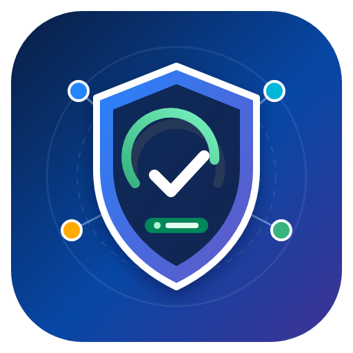
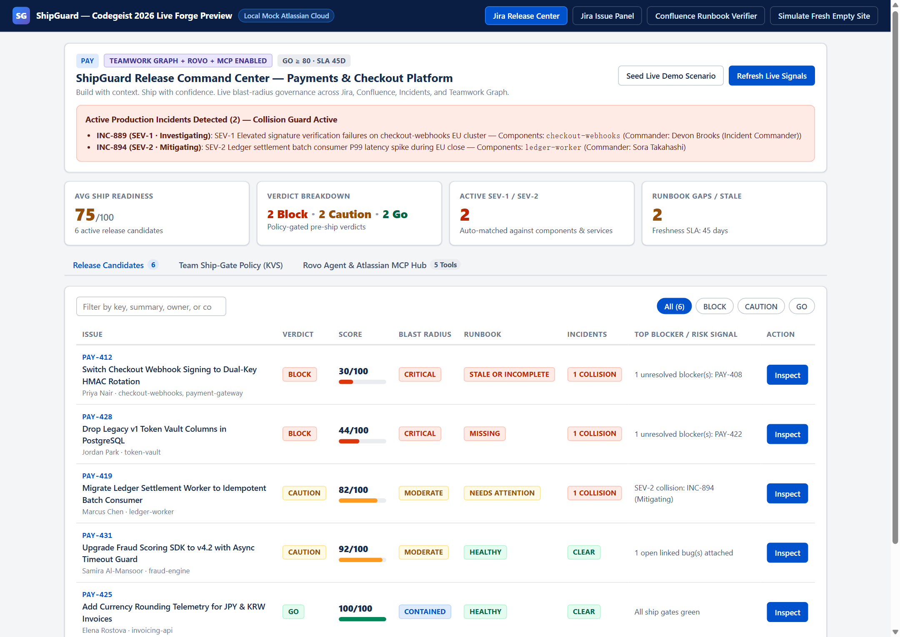
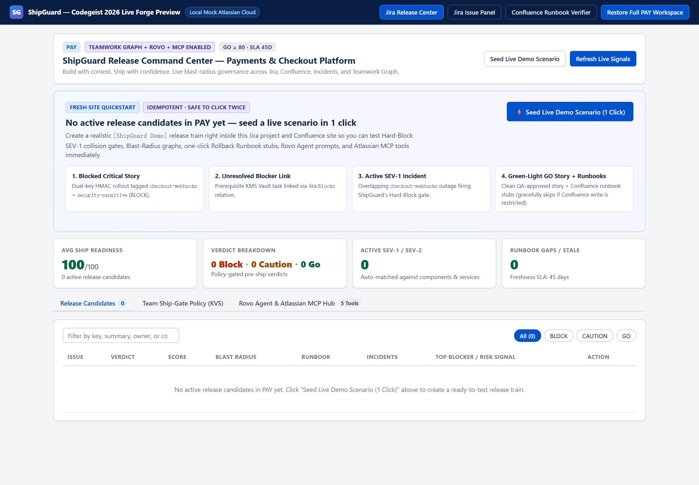
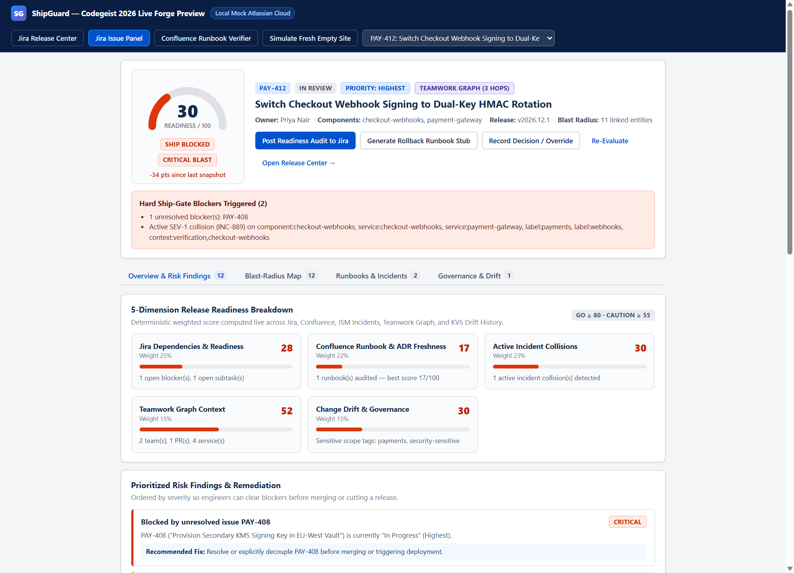
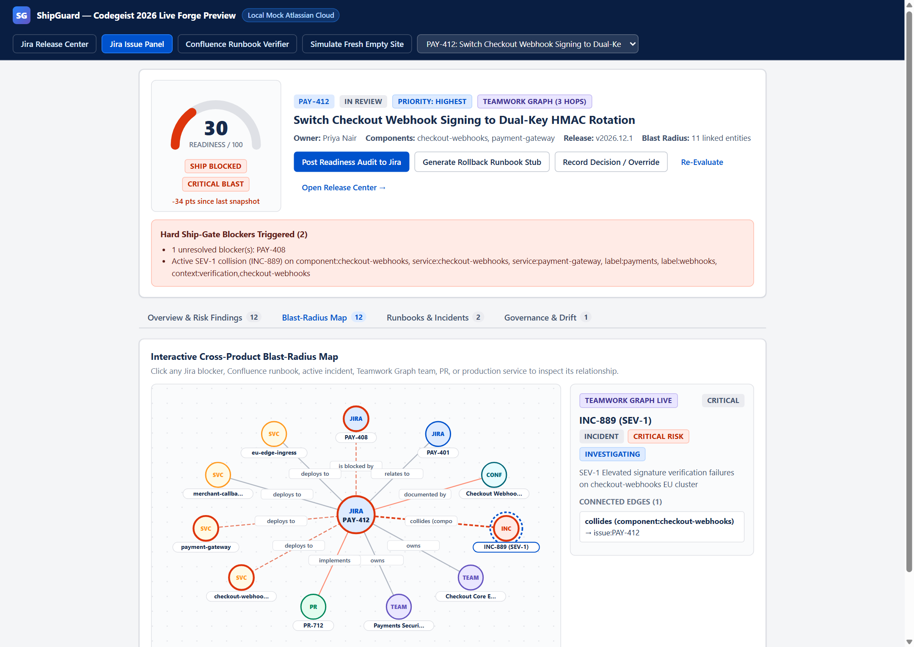
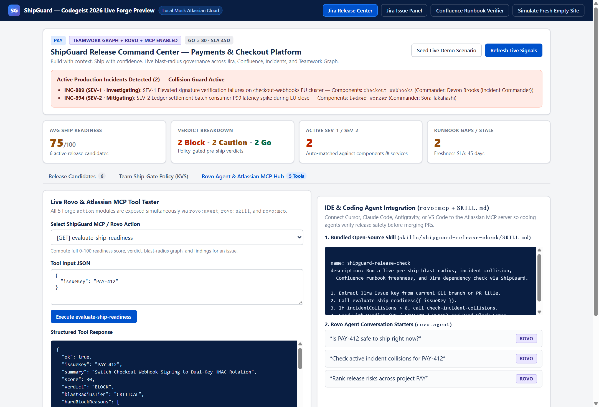
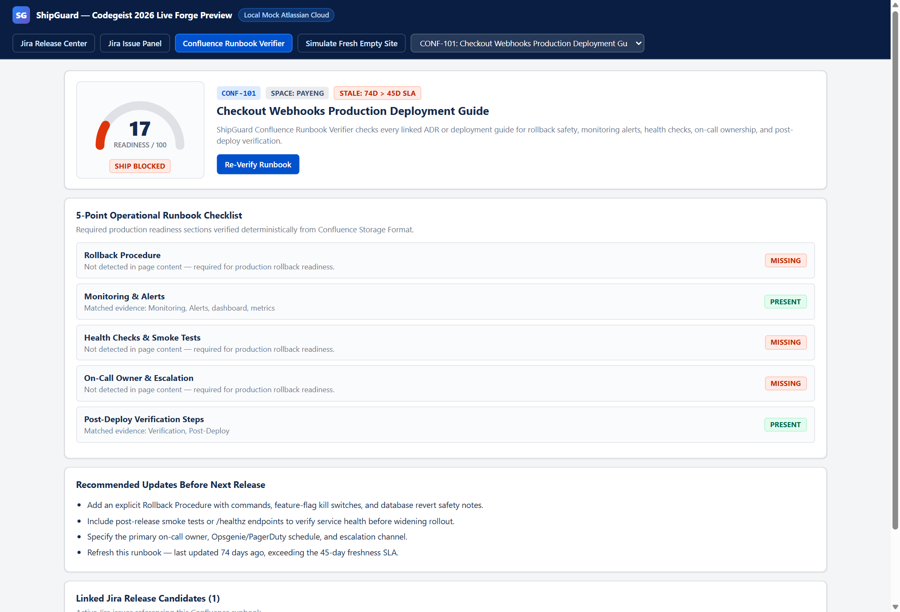
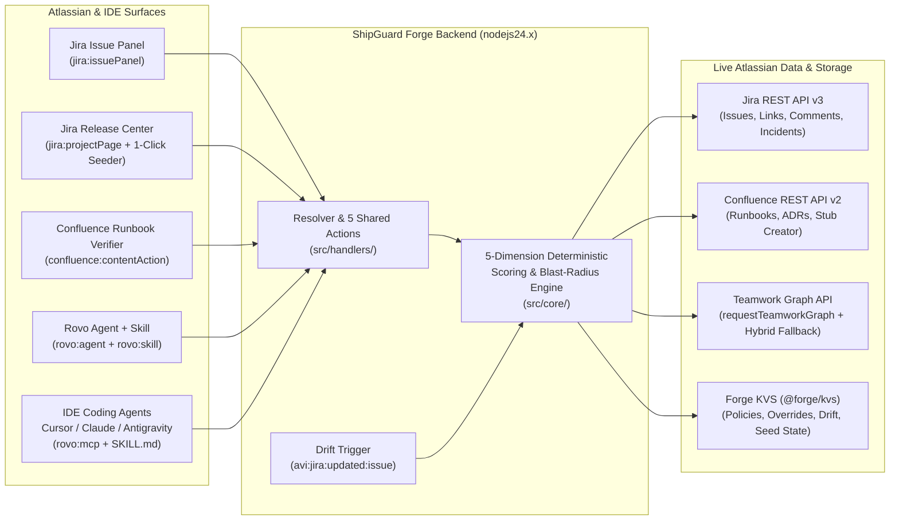

<p align="center">
  
</p>

<h1 align="center">ShipGuard — Pre-Ship Context Intelligence, Blast-Radius Guardian &amp; MCP/Rovo Bridge</h1>

<p align="center">
  <strong>Build with context. Ship with confidence.</strong><br/>
  Built for <strong>Codegeist 2026 (Atlassian)</strong> · Category: <strong>Apps for Software Teams</strong><br/>
  Stackable Bonus Tracks: <strong>Best Agents (Rovo)</strong> · <strong>Best App with Atlassian MCP</strong> · <strong>Best Apps with Teamwork Graph</strong> · <strong>Best Marketplace Published App</strong><br/><br/>
  <a href="https://youtu.be/sMD5Pfm51PQ"></a>
  <a href="LICENSE"></a>
  
</p>

---

ShipGuard is a multi-module **Atlassian Forge** application (`nodejs24.x`) that stops risky releases *before* engineers merge a pull request or trigger a deployment. It synthesizes live signals across **Jira**, **Confluence**, **Jira Service Management / Incidents**, **Atlassian Teamwork Graph**, and **Forge KVS** into a deterministic **0–100 Release Readiness Score**, an interactive **Blast-Radius Relationship Map**, a **One-Click Live Demo Scenario Seeder**, an autonomous **Rovo Agent + Reusable Skill**, and an **Atlassian MCP Server (`rovo:mcp`) + open-source `SKILL.md`** for IDE coding agents.

- **100% Runs on Atlassian Forge (`nodejs24.x`)** — Zero external network egress, zero paid Forge LLM API usage.
- **Judge-Proof 1-Click Live Demo Seeder** — Fresh Jira sites show a guided onboarding banner that idempotently seeds a live `[ShipGuard Demo]` scenario (blocked story, blocker link, active SEV-1 collision incident, green-light GO story, and Confluence runbooks) in one click.

---

## Product Visual Tour

### 1. Jira Project Release Command Center (`jira:projectPage`)
Ranks all active release candidates by pre-ship risk with active SEV-1/SEV-2 collision alerts, live KPIs, interactive `@forge/kvs` team policies, and the 1-Click Live Demo Seeder.



### 2. Fresh-Site Guided Onboarding & One-Click Demo Seeder (`seedDemoScenario`)
Eliminates the empty-site trap on brand-new Atlassian sites — creates realistic `[ShipGuard Demo]` Jira issues, blocker links, active SEV-1 collisions, and Confluence runbooks idempotently with graceful partial-permission fallback.



### 3. Jira Issue Panel (`jira:issuePanel`) & Interactive Blast-Radius Map
Displays the live 0–100 Readiness Gauge, hard ship-block gates, 5 weighted risk dimensions, one-click Rollback Runbook Stub generation, Forge KVS override audit trail, and interactive Teamwork Graph Blast-Radius Map.





### 4. Rovo Agent (`rovo:agent` + `rovo:skill`) & Atlassian MCP Server (`rovo:mcp` + `SKILL.md`)
All 5 Forge actions run identically inside Atlassian Rovo Chat and IDE coding agents (Cursor, Claude Code, Antigravity, VS Code). See [`mcp/README.md`](mcp/README.md) for copy-paste IDE setup configs.



### 5. Confluence Runbook Verifier (`confluence:contentAction`)
Deterministically audits any Confluence page for freshness SLA compliance and 5 mandatory operational pillars (*Rollback Procedure, Monitoring & Alerts, Health Checks, On-Call Escalation, Post-Deploy Verification*).



---

## Architecture Overview



---

## Forge Modules Declared in [`manifest.yml`](manifest.yml)

| Forge Module | Key | Purpose |
| :--- | :--- | :--- |
| `jira:issuePanel` | `shipguard-issue-panel` | Live 0–100 readiness gauge, hard-block banner, 5 risk dimensions, interactive Blast-Radius Map, one-click Confluence runbook generator, Jira audit commenter, and override modal. |
| `jira:projectPage` | `shipguard-release-center` | Project-wide Release Command Center ranking active release candidates by ship risk, 1-Click Live Demo Seeder, active incident collision ticker, interactive KVS policy editor, and Rovo/MCP Tool Hub. |
| `confluence:contentAction` | `shipguard-runbook-verifier` | Verifies any Confluence page against a 5-point operational checklist (Rollback, Monitoring, Health Checks, On-Call Escalation, Post-Deploy Verification) and freshness SLA. |
| `rovo:agent` | `shipguard-release-agent` | **ShipGuard Release Guardian** — cites live readiness scores, incident collisions, and runbook gaps; enforces human-confirmed governance overrides. |
| `rovo:skill` | `shipguard-release-skill` | Reusable agent skill packaging [`skills/shipguard-release-check/SKILL.md`](skills/shipguard-release-check/SKILL.md) and its 5 action tool dependencies. |
| `rovo:mcp` | `shipguard-mcp-server` | Exposes all 5 ShipGuard actions as Model Context Protocol tools via the Atlassian MCP Server for external coding agents. |
| `action` (×5) | `evaluate-ship-readiness`, `check-incident-collisions`, `audit-runbook-freshness`, `record-ship-decision`, `get-project-release-risk` | Shared typed backend tools invoked by `rovo:agent`, `rovo:skill`, and `rovo:mcp`. |
| `trigger` | `shipguard-issue-drift-trigger` | Subscribes to `avi:jira:updated:issue` to record readiness drift snapshots in `@forge/kvs`. |

---

## 5-Dimension Deterministic Release Readiness Engine

Every Jira issue receives a transparent weighted **0–100 score** and **GO / CAUTION / BLOCK** verdict:

1. **Jira Dependencies & Readiness (25%)** — Unresolved inward blockers (`is blocked by`), open linked bugs, incomplete subtasks, missing QA sign-off on high-priority issues, and unassigned release ownership.
2. **Confluence Runbook & ADR Freshness (22%)** — Evaluates linked Confluence runbooks via REST API v2 for 5 mandatory sections and team freshness SLA (default 45 days).
3. **Active Incident Collisions (23%)** — Scans open SEV-1/SEV-2 incidents matching components, labels, Teamwork Graph services, and contextual keywords. Active SEV-1 overlap triggers a configurable hard-block gate.
4. **Teamwork Graph Context & Blast Radius (15%)** — Calls `api.asUser().requestTeamworkGraph(...)` with curated GraphQL queries (with graceful hybrid fallback on fresh sites) to map owning Atlassian Teams, PR review state, contributors, and cross-service fan-out.
5. **Change Drift & Governance (15%)** — Tracks late risk regressions via `@forge/kvs` drift snapshots, flags high-risk labels (`db-migration`, `breaking-change`, `payments`, `auth`, `security-sensitive`) lacking security sign-off, and honors immutable `APPROVED` / `OVERRIDDEN` / `HELD` governance decisions.

---

## Local Development, Preview & Verification

```bash
npm install && npm --prefix static/shipguard-ui install
npm run build           # TypeScript typecheck + Vite Custom UI production bundle
npm run lint:manifest   # Official @forge/manifest FullValidationProcessor (0 errors, 0 warnings)
npm test                # Full Vitest unit & integration suite (scoring, seeder, Rovo/MCP, trigger, manifest)
npm run preview         # Launches local interactive preview server at http://127.0.0.1:4173
```

---

## Documentation & Submission Guides

- **[`mcp/README.md`](mcp/README.md)** — Copy-paste Atlassian MCP client setups for Cursor, Claude Code, Antigravity & VS Code + example pre-merge transcript.
- **[`skills/shipguard-release-check/SKILL.md`](skills/shipguard-release-check/SKILL.md)** — Bundled `rovo:skill` and open-source coding agent skill.
- **[`DEPLOY_GUIDE.md`](DEPLOY_GUIDE.md)** — Exact step-by-step deployment & Dev Console judge sharing link commands.
- **[`MARKETPLACE_KIT.md`](MARKETPLACE_KIT.md)** — 5-minute Atlassian Marketplace listing copy, privacy statement & reviewer instructions (4th bonus prize track).
- **[`SUBMISSION.md`](SUBMISSION.md)** — Ready-to-paste Devpost answers and Judge Testing Instructions.
- **[`DEMO_SCRIPT.md`](DEMO_SCRIPT.md)** — Sub-5-minute YouTube demo video script.
